<div align="center">



<br>


</div>

<br>

```python
import sqlite3

conn = sqlite3.connect("0r4y.db")
conn.execute("CREATE TABLE IF NOT EXISTS sobre (chave TEXT PRIMARY KEY, valor TEXT)")
conn.executemany("INSERT OR REPLACE INTO sobre VALUES (?, ?)", [
    ("usuario",   "0r4y"),
    ("linguagem", "Python"),
    ("banco",     "SQLite3"),
    ("faz",       "bots para Discord"),
    ("clima",     "chuvoso ☔"),
])

for chave, valor in conn.execute("SELECT * FROM sobre"):
    print(f"{chave:>10} → {valor}")
```

<br>

### ☔ Projeto em destaque

<table>
  <tr>
    <td>
      <a href="https://github.com/0r4y/Bot-discord"><b>🕯️ Bot-discord</b></a><br>
      <sub>Bot de comunidade para Discord em Python: moderação, tickets, sorteios, logs, boas-vindas
      e uma sociedade secreta com credenciais e GIFs gerados na hora.</sub><br><br>
      <code>python</code> <code>discord.py</code> <code>sqlite3</code>
    </td>
  </tr>
</table>

<br>


